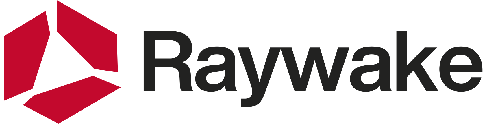

<p align="center">
  <a href="https://raywake.si/?utm_source=github&utm_medium=pin-engine&utm_campaign=oss&utm_content=readme-logo">
    <picture>
      <source media="(prefers-color-scheme: dark)" srcset="docs/assets/raywake-logo-dark.svg">
      
    </picture>
  </a>
</p>

<h1 align="center">pin-engine</h1>

<p align="center">
  <a href="https://raywake.si/?utm_source=github&utm_medium=pin-engine&utm_campaign=oss&utm_content=badge"></a>
  <a href="LICENSE"></a>
  
</p>

**Give it a product or blog link. It plans the Pinterest searches that page can win, makes
pins that show your real product, writes keyword-led titles and descriptions, and schedules
them on your Pinterest account at a human pace.**

Pinterest works like a search engine: people search, save what answers them, and click
through. pin-engine is built around that: every pin targets a different search phrase, answers
it in the pin, and links back to your page.

```bash
pin-engine demo "https://your-shop.com/products/linen-apron"
# -> output/2026-11-01-linen-apron/  3 pins, plan.json, preview.html (nothing published)
```

> **Built by the team behind [Raywake](https://raywake.si/?utm_source=github&utm_medium=pin-engine&utm_campaign=oss&utm_content=disclosure)**,
> the image engine behind every pin. Publishing goes through [Zernio](https://zernio.com), so
> you don't need Pinterest API approval. Sister project: [etsy-engine](https://github.com/oguzhankayan/etsy-engine).

## What it does

```text
 read ──► plan ──► render ──► check ──► preview ──► publish ──► stats
 your     Claude:   Raywake:   Claude     local       Zernio:     saves,
 page     keywords, product-   vision:    HTML,       scheduled   clicks,
          angles,   faithful   text and   nothing     pins, one   impressions
          copy      2:3 pins   product    published   a day       per pin
```

- **Your real product in every pin.** The product photo from your page goes to the image model
  as a reference; the pin places that exact product in a new scene instead of inventing one.
- **Search first.** Each pin gets its own search phrase, a title led by it and a description
  that answers it. No hashtags, no claims your page doesn't make.
- **Checked before you see it.** Claude looks at each image: misspelled headline, stray text or
  a changed product means one automatic retry.
- **Human cadence.** Pins are scheduled one per day in the evening by default, each on a board
  that matches its topic. Pins are marked as AI-generated on Pinterest.
- **Learns what works.** `pin-engine stats` ranks your pins by saves, the signal Pinterest uses
  to spread a pin.

## Quickstart

```bash
git clone https://github.com/oguzhankayan/pin-engine && cd pin-engine
python3 -m venv .venv && .venv/bin/pip install -e .
cp .env.example .env     # RAYWAKE_API_KEY, ANTHROPIC_API_KEY, ZERNIO_API_KEY
.venv/bin/pin-engine credits
.venv/bin/pin-engine demo "https://your-shop.com/products/your-product"
```

Keys: **Raywake** → [create an API key](https://raywake.si/api-keys?utm_source=github&utm_medium=pin-engine&utm_campaign=oss&utm_content=quickstart)
(scopes `generate` + `jobs:read`) · **Anthropic** → [console.anthropic.com](https://console.anthropic.com) ·
**Zernio** → [zernio.com](https://zernio.com), then connect your Pinterest account there.

## Step by step

```bash
pin-engine plan URL --count 5        # plan.json: keywords, titles, descriptions, scenes, boards
pin-engine render output/<folder>    # images (asks before spending), opens preview.html
pin-engine boards                    # your Pinterest boards through Zernio
pin-engine publish output/<folder> --create-boards    # shows the schedule, asks, then schedules
pin-engine stats                     # saves, clicks, impressions per pin
```

`plan.json` is yours to edit before rendering: change a title, a scene or a board name and
render again. `publish --every 48` spaces pins two days apart; `--start "2026-11-03 19:00"` sets
the first slot; `--draft` saves them in Zernio without scheduling.

Etsy listings are read through Etsy's open API (`ETSY_API_KEY` + `ETSY_SHARED_SECRET`). For any
page that can't be read, pass `--title "..." --photo product.jpg`.

## What a pin costs

Each image is quoted by Raywake before it runs and `render` asks before spending. The total is
printed at the end and in `preview.html`; `pin-engine credits` shows your balance.

<!-- TODO: measured run: N pins = $X images + $Y Claude -->

[Top up Raywake credits →](https://raywake.si/billing?utm_source=github&utm_medium=pin-engine&utm_campaign=oss&utm_content=readme-cost)

## Good to know

- Published pins cannot be edited or deleted through Zernio; `publish` always shows the
  schedule and asks first.
- Pinterest judges pins over weeks. Read `stats` after about 7 days before changing angles.
- Zernio keeps an unpublished upload for 7 days, so schedule within a week of publishing.

MIT licensed. Fork it, change anything.
